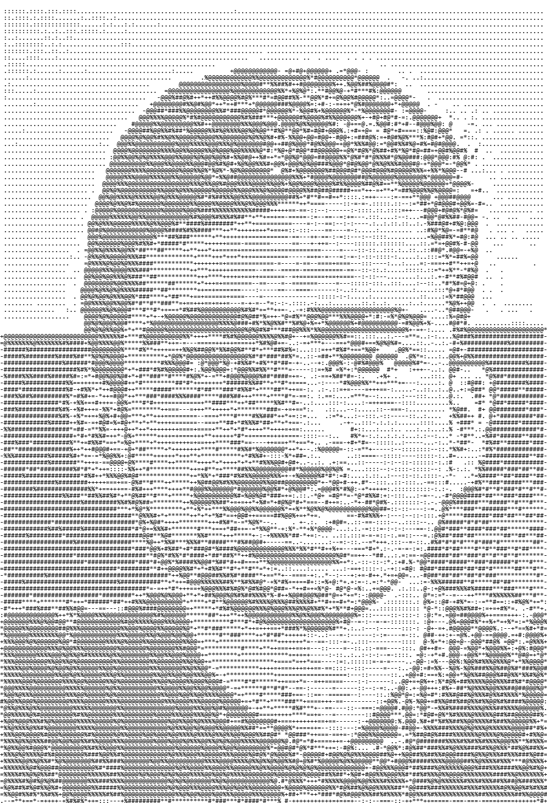

```text
                            ██╗   ██╗ ██╗  ██████╗ ████████╗  ██████╗  ██╗    ██╗  ██████╗  ██╗      ███████╗
                            ██║   ██║ ██║ ██╔════╝ ╚══██╔══╝ ██╔═══██╗ ██║    ██║ ██╔═══██╗ ██║      ██╔════╝
                            ██║   ██║ ██║ ██║         ██║    ██║   ██║ ██║ █╗ ██║ ██║   ██║ ██║      █████╗
                            ╚██╗ ██╔╝ ██║ ██║         ██║    ██║   ██║ ██║███╗██║ ██║   ██║ ██║      ██╔══╝
                             ╚████╔╝  ██║ ╚██████╗    ██║    ╚██████╔╝ ╚███╔███╔╝ ╚██████╔╝ ███████╗ ██║
                              ╚═══╝   ╚═╝  ╚═════╝    ╚═╝     ╚═════╝   ╚══╝╚══╝   ╚═════╝  ╚══════╝ ╚═╝
```

<div align="center">
<table style="width:100%;">
<tr>

<td width="42%" valign="top">

<p align="center">

</p>

</td>

<td width="58%" valign="top">
  
```
victowolf@github
────────────────────────────────────────────────────────────────

OS             :    Windows 11 / Ubuntu 24.04
Languages      :    Dart, Flutter, Python, C++
                    JavaScript, TypeScript

AI/ML          :    Deep Learning, Hugging Face

Systems        :    Dart SDK, DevTools, Networking
                    Docker, Kubernetes, Open Source

Development    :    Flutter, React, FastAPI, Node.js
                    Web, Desktop, Android & Extensions

Education      :    B.E. Computer Science

Location       :    Belagavi, Karnataka, India

Current        :    Google Summer of Code 2026
                    Dart SDK Contributor

Achievements   :    8× Hackathon Winner, SIH'25 Winner
                    Cardano Asia Winner, Google Summer of Code'26

LinkedIn       :    linkedin.com/in/yash-hosalli-70518a336/
```

</td>

</tr>
</table>
</div>
